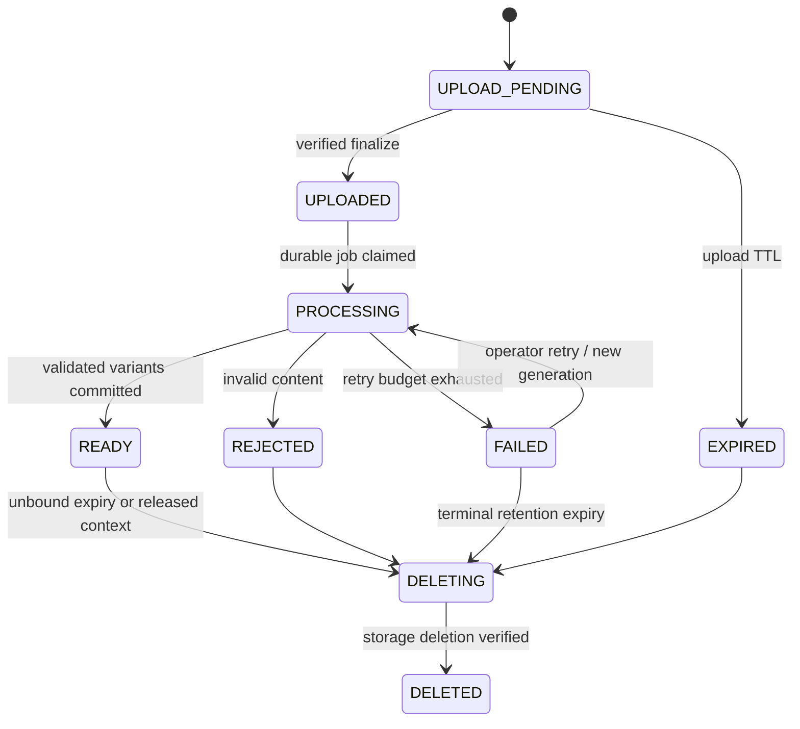

# Media lifecycle and object storage

Images are in the first usable content phase. Use an S3-compatible object store, AWS SDK for Java v2 adapter, private quarantine and delivery prefixes/buckets, versioning enabled, server-side encryption and least-privilege credentials. The Phase 4 local Compose/Testcontainers distribution is pinned PGSTY Silo, a MinIO-derived fork selected in [ADR-013](adr/013-local-object-storage-distribution.md); its runtime/security contract must be tested during implementation. Compose adds it in a `media` profile. Validate exact presigning, checksums, versioning and delete behavior against the chosen production S3 implementation before launch. Do not store binaries in PostgreSQL or assume every S3-compatible server has identical behavior.

## Upload sequence

Implementation checkpoint: [Phase 4](phases/phase-4.md) and
[local storage operations](../ops/media.md) record verified Compose/Testcontainers
storage and SDK primitives. The sequence below still requires lifecycle/API/worker
implementation; it is not delivered merely because the storage tests pass.

1. Authenticated verified user requests upload with purpose POST/AVATAR, declared MIME, bytes and SHA-256 checksum. Enforce rate/quota (initial 10 MiB/image, 40 megapixels, 10 attachments/post, 100 MiB pending upload quota/user, 1 GiB retained media/user configurable). Reserve quota and insert UPLOAD_PENDING asset. ID and quarantine key are backend-generated; original filename is metadata at most, never an object key.
2. Return presigned PUT URL expiring in 10 minutes plus required content type/checksum headers. Bucket CORS allows only configured frontend origins. A signed declared size/header is not relied on as the sole upload limit: reject oversized actual objects, configure ingress/storage controls, and account reserved bytes so uploads cannot bypass quotas. Prefer signed POST length conditions if the selected compatible store/SDK supports them consistently; changing transport does not change final validation.
3. Client uploads directly to quarantine, then calls finalize with asset ID and upload result/version identifier. Owner-only finalize probes trusted storage HEAD outside a transaction, checks expected key/version/size/checksum and performs state/version CAS in a short transaction to UPLOADED. No arbitrary external URL or key from the client is trusted.
4. Persist `MediaUploaded` plus durable processing job in that transaction. Return 202 with status URL. Duplicate finalize for the same verified version is idempotent. A competing/different version conflicts; no second unbounded processor run.
5. Worker claims with a lease and fencing generation, streams the **pinned object version** under strict byte/time/decode limits, verifies actual format/magic bytes, dimensions and checksum, decodes and re-encodes images, strips EXIF/location metadata, rejects malformed/polyglot/unsupported files, and produces display/thumbnail variants. Initial types JPEG/PNG/WebP, static images only; SVG/GIF/archives/executables rejected. Do not serve originals. Run processing with memory/CPU/time limits and no unnecessary network credentials. New file/document formats require malware scanning before release; do not enable them via MIME allowlist alone.
6. Write immutable variant keys including processing generation. Commit READY and metadata only if the worker still owns that generation. Partial outputs of failed/stale workers become cleanup candidates; only the committed READY generation is served. Retry transient storage/worker failures, terminal validation failures become REJECTED. Unsupported files never briefly become downloadable.
7. Publish post/update avatar calls `MediaCommands.bind` inside its own transaction. Check owner, intended purpose, READY state and no prior binding, lock all asset IDs in order, insert binding and owner-module FK references. Never trust media IDs just because upload was authenticated. All attachments bind or the post transaction rolls back.

READY is processing state; binding is a separate orthogonal record. Attached media remains READY until release. No optimistic “ATTACHED means safe to process” conflation.

Quota checks serialize on a per-owner media quota row before locking assets; a sum-then-insert query without a guard is insufficient. Accounting and storage lifecycle controls are specified in [database design](database-design.md#media). Generated variants count toward retained bytes. Binding does not charge a second copy. Concurrent uploads cannot each reserve the same remaining allowance.

## Overwrite, retries and failure safety

A presigned URL is a reusable bearer capability during its lifetime and may overwrite a key. [Amazon S3 presigned URL documentation](https://docs.aws.amazon.com/AmazonS3/latest/userguide/using-presigned-url.html). Therefore quarantine versioning/pinned versions are mandatory: worker never validates one version then serves another mutable key. Final URLs reference immutable processed versions, not the upload URL/key. Retry and duplicate-finalize tests must upload a later version after finalize and prove it cannot alter delivered bytes.

Object storage is not in the SQL transaction. Uploaded objects with no committed READY row stay quarantined; outputs without a committed row are orphans; a database rollback cannot make a partially uploaded file public. Use deterministic generation keys, idempotent operations, leases and reconciliation rather than distributed transactions. Storage failure during finalize leaves state retryable. Worker crash after writing variants but before commit reuses/verifies outputs or rewrites a fresh generation; stale generation cannot commit readiness.

Cleanup uses database-driven state claims and storage listing reconciliation. Pending intents expire after 15 minutes; READY unbound assets expire after 24 hours. Claims use row lock/CAS to DELETING before external delete so attach cannot race cleanup. Processing leases have bounded retries before terminal state; never delete a live processing generation based solely on created time. Delete all object versions/delete markers where policy requires erasure; deleting only the latest version is insufficient. Retry DELETING jobs until deletion is confirmed, then mark DELETED. Keep tombstone metadata for reconciliation without serving content.

Post deletion/removal immediately denies media URL issuance. Soft-deleted post bindings are released/purged after the content retention window; moderation hold may retain private evidence. Avatar replacement releases the old binding in the same transaction; purge runs later. Reconciliation finds context references without matching binding and fails them closed, emitting an alert; it does not infer permission from storage existence. Owner-only metadata status endpoint does not return bound download URLs. An uploader cannot bypass post removal via `/media/{id}`.

## Download authorization and future scope

Content/profile endpoints first authorize current resource access, then ask media for READY variant capabilities, max 60 seconds. Media has no dependency on content/profile: the owning module is the orchestrator, and there is no public “sign any media ID” API. Non-bound owner preview may use a separate owner-only capability for READY drafts, never rejected/quarantined content. Application responses use `Cache-Control: private, no-store` for signed URLs. Storage/CDN rules must not extend private capability TTL or expose public fallback paths. Previously issued URLs/bytes remain accessible until expiry/already downloaded; strict immediate byte revocation would require an authenticated delivery proxy, a future explicit tradeoff.

Thumbnails (e.g. max 320px) and display images (max 2048px) are generated together initially, preserving aspect ratio. Exact quality/dimension defaults are configuration after visual/size evaluation. Video later adds multipart upload, duration probing, isolated transcoding, poster frames, multiple renditions and significantly different quotas/lease times. Documents add antivirus/content-disposition policies and no inline active content. These add processors/kinds without changing post ownership or audience.
